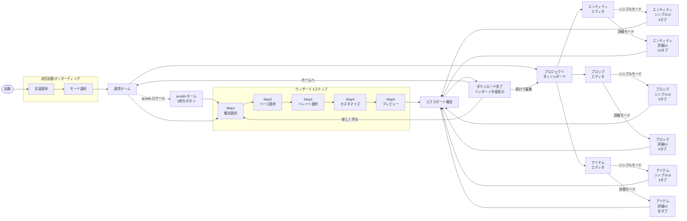

# UIデザイン設計

> 参照ドキュメント: `architecture.md` / `tech-stack.md` / `wizard-design.md` / `feature-toggle-design.md` / `i18n-design.md`

---

## 1. 移植元UIの現状分析

### 1.1 良い点（採用すべきUXパターン）

以下のUXパターンは移植先でそのまま採用または発展させる。

#### ウィザードのステップ進捗表示（`WizardFrame.tsx`）
- **採用理由**: ドット式進捗インジケーターと「N / M ステップ」テキストの組み合わせにより、ユーザーが「今どこにいるか・あとどれくらいか」を常に把握できる。初心者・子どもの不安感を軽減する効果が高い。
- **移植先での発展**: `ja-kids` モードでは「いまここだよ！」テキストと絵文字アイコン付きのプログレスバーに拡張する。

#### トレイトカード選択UI（`EntityTraitPicker.tsx`・`ContentWizard.tsx`）
- **採用理由**: アイコン付きグリッドカードを複数選択できる形式は、JSON 設定の複雑さを隠蔽しつつ直感的に特性を設定できる。子どもにとっても視覚的に分かりやすく、移植先の核心機能として価値が高い。
- **移植先での発展**: Tailwind CSS でカード選択状態（選択済み: グリーンリング + チェックマーク）を実装。`ja-kids` モードでは絵文字を大きく表示する。

#### モバイル優先の列順序フリップ（`Home.tsx` の `order={{ xs: 2, md: 1 }}`）
- **採用理由**: 小画面で教育コンテンツ（ウィザード起動ボタン等）を先表示する設計。タブレット・スマートフォン利用の子どもに特に有効。
- **移植先での発展**: Tailwind の `order-first md:order-last` で同等のレスポンシブ動作を実現する。

#### 編集モードの3段階選択（`FirstRunPanel.tsx`）
- **採用理由**: Focused / Intermediate / Advanced の段階的開示パターンは、スキルに合わせた UI を提供する優れた設計。初回起動時の心理的負担を下げる。
- **移植先での発展**: 「かんたんモード / くわしいモード」の2択に簡略化。`ja-kids` ロケール選択時はかんたんモードを自動設定する。

#### IDの自動生成（`EntityWizard.tsx` の `generateNameFromTraits`）
- **採用理由**: 選択したトレイトから英語IDを自動提案し手入力を最小化する。子どもにとって「ID（英数字のみ）」の概念は難解なため、自動生成が特に有効。
- **移植先での発展**: 表示名から自動生成する `generateIdFromDisplayName()` を実装し、ひらがな→ローマ字変換（`wanakana` ライブラリ）を組み合わせる。

#### 名前重複チェック（`getIdConflictError`）
- **採用理由**: 既存ファイルとのID衝突をリアルタイム検出してエラー表示する機能。ファイル生成後に気づくより、入力中に気づける方が格段にUXが良い。
- **移植先**: `useEntityDraft.ts` のカスタムフック内に `checkIdConflict()` を実装する。Zustand の `projectStore` と照合する。

#### 遅延ロード（`LazyComponents.tsx`）
- **採用理由**: Babylon.js（約8MB）はビューアモード遷移時のみロードして初期表示を高速化する設計。初回ロード体験に直結する重要なパフォーマンス設計。
- **移植先**: React の `lazy()` + `Suspense` で `PreviewPanel` を遅延ロードする。ローディング中はスケルトンUIを表示する。

#### テンプレートギャラリー（`ProjectGrid.tsx`）
- **採用理由**: カード形式のビジュアルテンプレート一覧。「アドオンスターター」から始めるフローが明快で、ゼロから考える必要がない安心感がある。
- **移植先**: プロジェクトダッシュボードに「テンプレートから始める」セクションを設ける。`ja-kids` モードでは絵文字付き大型カードで表示する。

---

### 1.2 改善が必要な点

#### ウィザードランチャーの情報過多
- **現状**: 「ガイド付きセットアップ」「サンプルから始める」「スクリプト」「スポーンルール」等がすべて同一画面に並び、どこから始めればよいか分かりにくい。特に初心者・子どもが迷いやすい。
- **改善方針**: 移植先では「モブ」「ブロック」「アイテム」の3択のみを最初に提示する。スクリプト・スポーンルール等の上級機能は詳細モードのみで表示する。

#### 技術的IDの二重入力
- **現状**: 「表示名」と「ID（英数字のみ）」の2フィールドを要求するが、"ID" の概念が子どもには難解。自動生成されるが説明が不十分。
- **改善方針**: `ja-kids` モードではID入力欄を非表示にして完全自動生成とする。表示名から自動的にIDを作り、小さいテキストで「えいごのなまえ: `my_cool_mob` を自動でつけたよ」と補足表示する。

#### スライダーの数値が技術的
- **現状**: 移動速度 `0.25` のような浮動小数点値は意味を直感的に理解できない。HP `20` もピンとこない。
- **改善方針**: `ja-kids` モードでは数値の代わりに「ゆっくり ◀──○──▶ はやい」のような抽象的ラベルを表示する。内部的には数値に変換するマッピングを定義する。

#### エンティティエディタの10タブ
- **現状**: 「コンポーネント」「ステートダイアグラム」「アクション」等の専門タブが最初から全表示されており、どこから触ればいいか分からない。
- **改善方針**: シンプルモードでは「外見」「ステータス」「スポーン」「ドロップ」の4タブのみ表示する。詳細モードで全タブを表示する（`feature-toggle-design.md` の設計に準拠）。

#### 「ゼロから作る」vs「バニラからカスタマイズ」の選択肢
- **現状**: どちらを選ぶべきか判断できない初心者向けの説明が不足している。特に子どもはどちらを選べばいいか分からない。
- **改善方針**: `ja-kids` モードではデフォルトで「バニラからカスタマイズ」を選択済みにし、「ゼロから作る」を小さく表示する。シンプルモードでは「バニラを選ぶ（おすすめ）」と推奨ラベルを付ける。

#### ファイルドロップ操作の説明文が長い
- **現状**: InspectPanel のドラッグ＆ドロップ説明は文字量が多く、子どもが読み飛ばしやすい。
- **改善方針**: `ja-kids` モードでは大きなアイコン（📂）と「ファイルをここにドラッグしてね」の1行テキストのみ表示する。

#### エクスポート後の手順が不明
- **現状**: `.mcaddon` ダウンロード後にMinecraftへどうインポートするか説明がない。
- **改善方針**: エクスポート完了画面に「次のステップ」セクションを追加し、「Minecraft を開く → 設定 → ストレージ → インポート」の手順を画像付き（またはアイコン付き）で説明する。

#### MUI → Tailwind CSS 移行で失う機能と代替手段

| MUIコンポーネント | 移植先での代替 | 注意点 |
|----------------|-------------|--------|
| `TextField` | `<input>` + Tailwind クラス + react-hook-form | フォーカス・エラー状態は Tailwind の `focus:` / `aria-invalid:` バリアントで実装 |
| `Autocomplete` | Radix UI Combobox（`@radix-ui/react-combobox` は未リリースのため暫定的に `cmdk` を使用） | ドロップダウン表示ロジックを自前実装する必要あり |
| `Slider` | `@radix-ui/react-slider` | スタイルは Tailwind で自由に設定可能 |
| `Dialog` | `@radix-ui/react-dialog` | アクセシビリティ対応済み。`DialogOverlay` / `DialogContent` に Tailwind クラスを適用 |
| `Tabs` | `@radix-ui/react-tabs` | 移植元と同等のタブ動作を実現可能 |
| `Select` | `@radix-ui/react-select` | スタイルカスタマイズが容易 |
| `Snackbar`（トースト） | `react-hot-toast` または `sonner` | エラー・成功通知に使用 |
| `DatePicker` | Phase 1 では不使用。将来必要な場合 `react-day-picker` を採用 | ウィザード・エディタにDate選択は不要 |
| `Tooltip` | `@radix-ui/react-tooltip` | ツールチップのアクセシビリティ対応が重要 |
| MUI カラーテーマ | Tailwind CSS v4 の `@theme` ブロック + CSS 変数 | ダーク/ライトモード切り替えは CSS 変数で対応 |

---

## 2. 改善提案一覧

### 提案 1: 初回起動オンボーディングフローの導入
- **改善内容**: アプリ初回起動時に「ようこそ」画面を表示し、①言語選択（English / 日本語 / かんたん日本語）→②モード選択（かんたんモード / くわしいモード）→③ホーム画面、の3ステップで案内する。移植元の `FirstRunPanel.tsx` を参考にしつつ、言語選択を最初に置く。
- **理由**: 初回起動時に「どこから始めればよいか」が最も不安な瞬間。言語とモードを先に確定させることで、その後のすべての画面が適切なコンテキストで表示される。
- **対象ロケール**: 全体（表示は選択した言語で）
- **対象モード**: 両方（選択前のため）

### 提案 2: エラーメッセージの絵文字付き平易化
- **改善内容**: バリデーションエラーを「❌ エラーコード」ではなく「😮 名前をいれてね！」のように絵文字 + 平易な文章で表示する。エラー種別ごとにアイコンと訳語を定義する（`i18n-design.md` Section 6 参照）。
- **理由**: 移植元は英語の技術的エラーメッセージが多く、子どもや初心者が意味を理解できない。エラーを「失敗」ではなく「次のヒント」として捉え直す表現に変える。
- **対象ロケール**: ja / ja-kids（特に ja-kids を重点整備）
- **対象モード**: シンプル（詳細モードは従来の技術的エラーを追加表示する）

### 提案 3: ローディング状態のスケルトンUI導入
- **改善内容**: データ読み込み中はスピナーではなくスケルトンUI（コンテンツのグレー輪郭）を表示する。Tailwind の `animate-pulse` クラスで実装する。
- **理由**: スピナーは「何かが起きているが何かは不明」という不安感を生む。スケルトンUIは読み込み後のレイアウトを予告し、ユーザーの認知的負荷を下げる。
- **対象ロケール**: 全体
- **対象モード**: 両方

### 提案 4: 成功フィードバックのアニメーション強化
- **改善内容**: エクスポート完了・保存完了・トレイト選択完了などの成功イベントに対して、✅ チェックマークのアニメーション + トースト通知を表示する。`ja-kids` モードでは画面上部から「✨ できたよ！」のアニメーションを落下させる。
- **理由**: 移植元は成功フィードバックが薄く、操作が完了したか不安になりやすい。特に子どもは「できた！」の実感が重要で、モチベーション維持に直結する。
- **対象ロケール**: 全体（`ja-kids` のみアニメーション強化）
- **対象モード**: 両方

### 提案 5: 子ども向け大型タッチターゲット
- **改善内容**: `ja-kids` モードのすべてのインタラクティブ要素に `min-h-14`（56px）以上を適用する。ボタンは `w-full` 全幅推奨。フォント最小サイズを `1.25rem`（20px）に設定する。
- **理由**: 子どもはタッチ精度が低く、小さいボタンや狭いリンクを誤タップしやすい。WCAG 2.1 の 2.5.5 では44px以上のターゲットサイズを推奨しており、56px は余裕を持った実装。
- **対象ロケール**: ja-kids
- **対象モード**: シンプル

### 提案 6: 絵文字によるコンテンツ種別の視覚的識別
- **改善内容**: ウィザードStep1の種別選択カード・エディタタブ・プロジェクトダッシュボードのカードに絵文字アイコンを常時表示する。モブ=🐾、ブロック=🧱、アイテム=⚔️ を標準アイコンとして全ロケールに適用する。
- **理由**: 文字が読めない年齢層でも絵文字で識別できる。また、lucide-react の抽象的なアイコンよりも「Minecraft感」が出てブランド統一感が生まれる。
- **対象ロケール**: 全体（特に ja-kids で重要）
- **対象モード**: 両方

### 提案 7: MUI Autocomplete の代替（バニラカタログ検索）
- **改善内容**: Step2のバニラカタログ検索に `cmdk`（Command Menu）ライブラリを採用し、キーボード対応の検索可能ドロップダウンを実装する。モバイルでは全画面モーダル形式に切り替える。
- **理由**: MUI `Autocomplete` の移行先として `@radix-ui/react-combobox` は未リリース（2025年時点）。`cmdk` は headless で Tailwind と相性がよく、キーボードナビゲーション・スクリーンリーダー対応が整っている。
- **対象ロケール**: 全体
- **対象モード**: 両方（`ja-kids` モードでは検索欄を非表示にして全件グリッド表示のみにする選択肢も検討）

### 提案 8: キーボードナビゲーションの完全対応
- **改善内容**: すべてのインタラクティブ要素を `Tab` キーで順に移動できるようにする。ウィザードの「次へ」ボタンに `Enter` キーを対応させる。モーダルは `Escape` で閉じる。フォーカスリングは `outline-2 outline-primary-500` で視認性を確保する。
- **理由**: マウスやタッチ操作が困難なユーザーへの対応。また、キーボードで快適に操作できる設計はスクリーンリーダーの動作保証にも直結する。Radix UI の各プリミティブはデフォルトでキーボード対応済みのため、実装コストは低い。
- **対象ロケール**: 全体
- **対象モード**: 両方

### 提案 9: スクリーンリーダー対応（ARIA強化）
- **改善内容**: ステップ進捗バーに `aria-label="5ステップ中1ステップ目"` を設定する。エラーメッセージには `role="alert"` を付与してスクリーンリーダーが即座に読み上げるようにする。ウィザードのカード選択には `aria-pressed="true/false"` を使用する。ローディング中は `aria-live="polite"` で状態変化を通知する。
- **理由**: 視覚障碍を持つユーザーがアドオン作成に参加できるようにするためのアクセシビリティ対応。WCAG 2.1 AA 準拠を目標とする。
- **対象ロケール**: 全体
- **対象モード**: 両方

### 提案 10: モバイルファーストレスポンシブレイアウト
- **改善内容**: すべての画面を `sm`（640px）以下でシングルカラム・フルスクリーンになるように設計する。ウィザードのカード選択は `sm` 以下で1〜2列、`md` 以上で3列。エディタのタブバーはスマートフォンで `overflow-x-auto` のスクロール可能なタブに切り替える。
- **理由**: 子どもはタブレットやスマートフォンでアクセスする割合が高い。移植元はデスクトップ前提の設計のため、モバイルでの操作性が低い。
- **対象ロケール**: 全体（特に ja-kids）
- **対象モード**: シンプル優先

### 提案 11: Minecraftインポート手順ガイドの統合
- **改善内容**: エクスポート完了画面に「Minecraftに入れる方法」セクションを追加する。「①Minecraftを開く → ②設定 → ③ストレージ → ④インポート → ⑤ダウンロードしたファイルを選ぶ」の5ステップを番号付きリストとアイコンで説明する。
- **理由**: 移植元はエクスポート後の手順が一切説明されておらず、初心者が詰まりやすい最大のポイント。子どもが保護者に聞かなくても自分でインポートできるようにする。
- **対象ロケール**: ja / ja-kids（`en` は既存ドキュメントが充実しているため優先度低）
- **対象モード**: 両方

### 提案 12: スライダーの抽象的ラベル表示（ja-kidsモード）
- **改善内容**: `ja-kids` モードのスライダーに数値ラベルの代わりに段階的テキストラベルを表示する。例：移動速度 → 「ゆっくり ◀───○───▶ はやい」、体力 → 「よわい ◀───○───▶ つよい」。内部的には値レンジを5〜7段階にマッピングするヘルパー関数を実装する。
- **理由**: 浮動小数点値（`0.25`）や整数値（`20`）は子どもに意味が伝わらない。抽象的なラベルにすることで、どの値を設定するか直感的に判断できる。
- **対象ロケール**: ja-kids
- **対象モード**: シンプル

---

## 3. 画面一覧

| # | 画面名 | 説明 | 対応コンポーネント（移植先） | 対応する移植元コンポーネント |
|---|--------|------|---------------------------|----------------------------|
| 1 | ホーム画面（通常） | 言語選択・モード選択・新規作成・既存プロジェクトを開く | `src/features/projectDashboard/DashboardPage.tsx` | `app/src/UX/home/Home.tsx` |
| 2 | ホーム画面（ja-kids バリアント） | 3択大ボタン（モブ・ブロック・アイテム）のみのシンプル画面 | `DashboardPage.tsx`（`ja-kids` ロケール時の条件レンダリング） | `app/src/UX/home/Home.tsx`（バリアントなし → 新規設計） |
| 3 | 初回起動画面 | 言語選択 → モード選択の2ステップオンボーディング | `src/components/onboarding/FirstRunWizard.tsx` | `app/src/UX/home/FirstRunPanel.tsx` |
| 4 | ウィザード Step 1: コンテンツ種別選択 | モブ・ブロック・アイテムの3択カード | `src/features/wizard/steps/Step1ContentType.tsx` | `app/src/UX/home/ContentWizard.tsx`（種別選択部分） |
| 5 | ウィザード Step 2: ベース選択 | バニラカタログ検索 or ゼロから作る | `src/features/wizard/steps/Step2BaseSelection.tsx` | `app/src/UX/home/ContentWizard.tsx`（テンプレート選択部分） |
| 6 | ウィザード Step 3: トレイト選択 | 絵文字付きグリッドカードでトレイトを複数選択 | `src/features/wizard/steps/Step3TraitSelection.tsx` | `app/src/UX/home/EntityWizard.tsx`（Step0）/ `EntityTraitPicker.tsx` |
| 7 | ウィザード Step 4: カスタマイズ | 名前・ステータス・外観の入力フォーム | `src/features/wizard/steps/Step4Customize.tsx` | `app/src/UX/home/EntityWizard.tsx`（Step1〜3） |
| 8 | ウィザード Step 5: プレビュー | 3Dプレビュー + 完成サマリー + エクスポートボタン | `src/features/wizard/steps/Step5Preview.tsx` | `app/src/UX/home/EntityWizard.tsx`（完成画面） |
| 9 | エンティティエディタ（シンプルモード） | トレイト・ステータス・外観・スポーン・ドロップの4タブ | `src/features/entityEditor/EntityEditorPage.tsx`（シンプル） | `app/src/UX/editors/entityType/EntityTypeEditor.tsx`（4タブ相当） |
| 10 | エンティティエディタ（詳細モード） | 移植元10タブ相当のフルUI（コンポーネント・状態グラフ・JSON含む） | `src/features/entityEditor/EntityEditorPage.tsx`（詳細） | `app/src/UX/editors/entityType/EntityTypeEditor.tsx`（全10タブ） |
| 11 | ブロックエディタ（シンプルモード） | トレイト・形状・属性の3タブ | `src/features/blockEditor/BlockEditorPage.tsx`（シンプル） | `app/src/UX/editors/blockType/BlockTypeEditor.tsx`（3タブ相当） |
| 12 | ブロックエディタ（詳細モード） | 移植元6タブ相当（パーミュテーション・JSON含む） | `src/features/blockEditor/BlockEditorPage.tsx`（詳細） | `app/src/UX/editors/blockType/BlockTypeEditor.tsx`（全6タブ） |
| 13 | アイテムエディタ（シンプルモード） | トレイト・外観・属性の3タブ | `src/features/itemEditor/ItemEditorPage.tsx`（シンプル） | `app/src/UX/editors/itemType/ItemTypeEditor.tsx`（3タブ相当） |
| 14 | アイテムエディタ（詳細モード） | 移植元3タブ + Attachable・JSON | `src/features/itemEditor/ItemEditorPage.tsx`（詳細） | `app/src/UX/editors/itemType/ItemTypeEditor.tsx`（全3タブ） |
| 15 | プロジェクトダッシュボード | 保存済みプロジェクト一覧・テンプレートギャラリー・新規作成 | `src/features/projectDashboard/DashboardPage.tsx` | `app/src/UX/home/projectGrid/ProjectGrid.tsx` / `Home.tsx` |
| 16 | エクスポート確認画面 | バリデーション結果・ダウンロードボタン・インポート手順ガイド | `src/features/export/ExportConfirmPage.tsx` | `app/src/UX/home/EntityWizard.tsx`（エクスポート部分） |

---

## 4. 画面遷移図



> **凡例**
> - 実線矢印 `-->`: 通常の画面遷移
> - 破線矢印 `-.->`: ja-kids ロケール選択時のみ発生する遷移（通常ホームの代わりにja-kidsホームを表示）
> - `シンプルモード` / `詳細モード` ラベル: `uiModeStore` の状態によって分岐するルート

---

## 5. デザインシステム方針

### 5.1 カラーパレット

Minecraftの世界観（緑・茶・黒）をベースにしたカラーパレット。CSS変数で定義し、Tailwind CSS v4 の `@theme` ブロックで参照する。

```css
/* src/styles/theme.css */
@import "tailwindcss";

@theme {
  /* ===== プライマリカラー（Minecraftグリーン系） ===== */
  --color-primary-50:  #f0f8ea;
  --color-primary-100: #d9edce;
  --color-primary-200: #b4dba0;
  --color-primary-300: #8cc873;
  --color-primary-400: #6db64e;
  --color-primary-500: #5D9C3B;   /* メインブランドカラー */
  --color-primary-600: #4c8030;
  --color-primary-700: #3b6424;
  --color-primary-800: #2b4a1a;
  --color-primary-900: #1b3010;

  /* ===== 背景色（ダークテーマ・土系） ===== */
  --color-bg-base:     #1c1c1c;   /* ページ背景（ほぼ黒） */
  --color-bg-surface:  #2d2d2d;   /* カード・パネル背景 */
  --color-bg-elevated: #3a3a3a;   /* 浮き上がったコンポーネント */

  /* ===== テキスト色 ===== */
  --color-text-primary:   #f5f5f5; /* 主要テキスト */
  --color-text-secondary: #b0b0b0; /* 補助テキスト */
  --color-text-muted:     #757575; /* 非活性テキスト */
  --color-text-on-primary: #ffffff;/* プライマリカラー上のテキスト */

  /* ===== ボーダー色 ===== */
  --color-border-default: #4a4a4a;
  --color-border-focus:   #5D9C3B; /* フォーカス時はグリーン */
  --color-border-error:   #ef4444;

  /* ===== セマンティックカラー ===== */
  --color-success: #22c55e;
  --color-warning: #f59e0b;
  --color-error:   #ef4444;
  --color-info:    #3b82f6;

  /* ===== Minecraftブランドアクセント ===== */
  --color-mc-dirt:   #8B6914;   /* 土の茶色 */
  --color-mc-wood:   #A0522D;   /* 木の茶色 */
  --color-mc-stone:  #808080;   /* 石のグレー */
  --color-mc-gold:   #FFD700;   /* 金のイエロー（ボスUI等） */
  --color-mc-diamond: #4FC3F7;  /* ダイヤモンドのブルー */
}

/* ===== ja-kids モード: 明るいバリアント ===== */
/* data-kids-mode 属性またはクラスで切り替え */
[data-locale="ja-kids"] {
  --color-bg-base:     #E8F5E9;  /* 淡いグリーン背景 */
  --color-bg-surface:  #FFFFFF;
  --color-bg-elevated: #F5F5F5;
  --color-text-primary:   #1a1a1a; /* 白背景のため暗いテキスト */
  --color-text-secondary: #555555;
  --color-primary-500: #4CAF50;    /* 少し明るいグリーン */
  --color-border-focus: #4CAF50;
}
```

**使用例（Tailwindクラス）**

```html
<!-- プライマリボタン -->
<button class="bg-[--color-primary-500] text-[--color-text-on-primary] hover:bg-[--color-primary-600]">
  次へ
</button>

<!-- エラーテキスト -->
<p class="text-[--color-error]">名前を入力してください</p>

<!-- カード背景 -->
<div class="bg-[--color-bg-surface] border border-[--color-border-default]">...</div>
```

---

### 5.2 タイポグラフィ

**フォント設定**

```css
@theme {
  /* 日本語: Noto Sans JP（@fontsource/noto-sans-jp で提供） */
  /* 英語: システムフォントスタック */
  --font-sans: "Noto Sans JP", ui-sans-serif, system-ui, -apple-system,
               BlinkMacSystemFont, "Segoe UI", sans-serif;

  /* コードエディタ（Monaco等）用等幅フォント */
  --font-mono: ui-monospace, "Cascadia Code", "Source Code Pro",
               Menlo, Consolas, "Courier New", monospace;
}
```

**サイズスケール**

| トークン | サイズ | 通常モード用途 | ja-kids モード用途 |
|---------|-------|-------------|------------------|
| `text-xs` | 0.75rem (12px) | 補足テキスト・バッジ | （使用しない） |
| `text-sm` | 0.875rem (14px) | ラベル・ヘルプテキスト | （使用しない） |
| `text-base` | 1rem (16px) | 本文・フォーム | — |
| `text-lg` | 1.125rem (18px) | カードタイトル | 本文・フォームラベル |
| `text-xl` | 1.25rem (20px) | セクション見出し | ボタンラベル |
| `text-2xl` | 1.5rem (24px) | ページ見出し | カードタイトル |
| `text-3xl` | 1.875rem (30px) | ウィザードタイトル | ステップタイトル |
| `text-4xl` | 2.25rem (36px) | — | ja-kids ホームの大ボタン |

**行間・文字間隔**

```css
@theme {
  --leading-normal: 1.5;     /* 本文 */
  --leading-relaxed: 1.75;   /* ja-kids 本文（読みやすさ優先） */
  --leading-tight: 1.25;     /* 見出し */
  --tracking-wide: 0.05em;   /* ja-kids ラベル（文字間隔を広げる） */
}
```

---

### 5.3 スペーシング

Tailwind CSS v4 の `@theme` ブロックベースで定義。**8pxグリッド**を基本単位とする。

```css
@theme {
  /* Tailwind v4 デフォルトの --spacing は 0.25rem(4px) 単位
     8px グリッドは spacing-2 = 8px、spacing-4 = 16px、spacing-8 = 32px で実現 */

  /* コンポーネント固有スペース */
  --spacing-wizard-gap:  2rem;    /* ウィザードカード間 (32px) */
  --spacing-section-gap: 1.5rem;  /* セクション間 (24px) */
  --spacing-card-pad:    1.5rem;  /* カード内パディング (24px) */
  --spacing-form-gap:    1rem;    /* フォーム項目間 (16px) */
}
```

**8pxグリッド対応表**

| Tailwindクラス | ピクセル | 用途 |
|-------------|-------|------|
| `p-1` / `m-1` | 4px | 要素内の微調整 |
| `p-2` / `m-2` | 8px | インライン要素のパディング |
| `p-3` / `m-3` | 12px | 小さいボタン・バッジ |
| `p-4` / `m-4` | 16px | 標準パディング |
| `p-6` / `m-6` | 24px | カード・セクション |
| `p-8` / `m-8` | 32px | ページ余白 |
| `p-12` / `m-12` | 48px | 大きなセクション区切り |

---

### 5.4 コンポーネントサイズ方針

**通常モード（デスクトップ優先）**

```css
/* ボタン */
.btn-base {
  min-height: 36px;   /* min-h-9 */
  padding: 0.5rem 1rem; /* py-2 px-4 */
  font-size: 0.875rem;  /* text-sm */
  border-radius: 6px;   /* rounded-md */
}

/* 入力フィールド */
.input-base {
  min-height: 36px;
  padding: 0.375rem 0.75rem;
  font-size: 0.875rem;
}

/* タッチターゲット最小サイズ（WCAG 2.1 2.5.5 準拠） */
.touch-target { min-height: 44px; min-width: 44px; }
```

**ja-kids モード（タッチ優先）**

```css
/* ja-kids ボタン */
.btn-kids {
  min-height: 56px;   /* min-h-14 */
  width: 100%;        /* w-full */
  padding: 1rem 1.5rem; /* py-4 px-6 */
  font-size: 1.25rem;   /* text-xl */
  font-weight: 700;     /* font-bold */
  border-radius: 1rem;  /* rounded-2xl */
  letter-spacing: 0.05em; /* tracking-wide */
}

/* ja-kids 入力フィールド */
.input-kids {
  min-height: 56px;
  font-size: 1.125rem; /* text-lg */
  padding: 0.75rem 1rem;
}
```

---

### 5.5 アイコン方針

**通常モード・詳細モード**: `lucide-react` をベースアイコンライブラリとして使用する。

```tsx
// 通常モードでのアイコン使用例
import { Plus, Download, ArrowRight, ArrowLeft, Settings } from 'lucide-react';

<button>
  <Download className="w-4 h-4 mr-2" />
  エクスポート
</button>
```

**ja-kids モード**: 絵文字アイコンを積極的に活用し、lucide-react アイコンを補助的に使う。絵文字はユニバーサルに認識でき、追加パッケージ不要。

```tsx
// ja-kids モードでのアイコン使用例
const { mode } = useUiMode();

<button>
  {mode === 'simple' && locale === 'ja-kids' ? '📥 ' : <Download className="w-4 h-4 mr-2" />}
  {t('common.button.export')}
</button>
```

**絵文字マッピング表（ja-kidsモード）**

| カテゴリ | 項目 | 絵文字 |
|---------|------|-------|
| **コンテンツ種別** | モブ（生き物） | 🐾 |
| | ブロック | 🧱 |
| | アイテム | ⚔️ |
| | 食べ物 | 🍗 |
| | ツール | ⛏️ |
| | 防具 | 🛡️ |
| **操作** | 次へ進む | ➡️ |
| | 戻る | ⬅️ |
| | ダウンロード | 📥 |
| | 保存 | 💾 |
| | 削除・消す | 🗑️ |
| | 完了・できた | ✅ |
| | エラー | ❌ |
| | 警告 | ⚠️ |
| | 設定 | ⚙️ |
| | 検索 | 🔍 |
| | 新しく作る | ✨ |
| | 開く | 📂 |
| **トレイト（モブ）** | 敵対的 | 🗡️ |
| | 友好的 | 🕊️ |
| | 飛行 | 🦅 |
| | テイム可能 | 💙 |
| | 騎乗可能 | 🐎 |
| | アンデッド | 💀 |
| | 水中生活 | 🌊 |
| | ボス | 👑 |
| | 繁殖可能 | 🍼 |
| | スライム | 🟢 |
| **トレイト（ブロック）** | 光る | 💡 |
| | 作業台 | 🔨 |
| | ドア | 🚪 |
| | スラブ | ◻️ |
| | 階段 | 🪜 |
| | フェンス | 🔲 |
| | 燃えやすい | 🔥 |
| | 滑る | 🧊 |
| **トレイト（アイテム）** | 食べ物 | 🍗 |
| | 剣 | ⚔️ |
| | ツルハシ | ⛏️ |
| | 斧 | 🪓 |
| | シャベル | 🪝 |
| | 防具 | 🛡️ |
| | 投げられる | 🎯 |
| | 大量持ち運び | 📦 |

---

## 6. ja-kids モード専用UX配慮事項

`ja-kids` ロケール（`i18next.language === 'ja-kids'`）時に適用する専用のUX設計。
Zustand `uiModeStore` のモードは常に `'simple'` として扱い、詳細機能は完全に非表示にする。

---

### 6.1 大きなボタン（min-h-14・全幅推奨）

タッチターゲットを56px以上にして誤タップを防ぐ。

```tsx
// src/components/shared/Button.tsx
import { useTranslation } from 'react-i18next';
import { cn } from '@/utils/cn';

interface ButtonProps extends React.ButtonHTMLAttributes<HTMLButtonElement> {
  variant?: 'primary' | 'secondary' | 'danger';
}

export const Button: React.FC<ButtonProps> = ({ className, children, ...props }) => {
  const { i18n } = useTranslation();
  const isKids = i18n.language === 'ja-kids';

  return (
    <button
      className={cn(
        // ベーススタイル
        'inline-flex items-center justify-center gap-2 rounded-md font-medium',
        'transition-colors focus-visible:outline-none focus-visible:ring-2',
        'focus-visible:ring-[--color-border-focus] disabled:opacity-50',
        // 通常モード
        'min-h-9 px-4 py-2 text-sm',
        // ja-kids モードで上書き
        isKids && 'min-h-14 w-full px-6 py-4 text-xl font-bold rounded-2xl tracking-wide',
        className,
      )}
      {...props}
    >
      {children}
    </button>
  );
};
```

**Tailwindクラスまとめ**

| 属性 | 通常モード | ja-kids モード |
|-----|-----------|--------------|
| 高さ | `min-h-9`（36px） | `min-h-14`（56px） |
| 幅 | `w-auto`（コンテンツ幅） | `w-full`（全幅） |
| フォントサイズ | `text-sm`（14px） | `text-xl`（20px） |
| 角丸 | `rounded-md`（6px） | `rounded-2xl`（16px） |
| 文字間隔 | デフォルト | `tracking-wide` |

---

### 6.2 絵文字アイコンの活用

5.5節の絵文字マッピング表に基づき、各コンテンツ種別・操作に絵文字を対応させる。
`ja-kids` モードでは lucide-react アイコンを絵文字に置き換えるか、アイコンの前に絵文字を追加する。

```tsx
// src/features/wizard/steps/Step1ContentType.tsx
import { useTranslation } from 'react-i18next';

const CONTENT_TYPE_EMOJIS = {
  entity: '🐾',
  block:  '🧱',
  item:   '⚔️',
} as const;

export const ContentTypeCard: React.FC<{ type: 'entity' | 'block' | 'item' }> = ({ type }) => {
  const { t, i18n } = useTranslation();
  const isKids = i18n.language === 'ja-kids';
  const emoji = CONTENT_TYPE_EMOJIS[type];

  return (
    <button className={cn(
      'flex flex-col items-center gap-3 p-6 rounded-xl border-2',
      'hover:border-[--color-primary-500] transition-colors',
      isKids && 'min-h-40 text-5xl gap-4', // ja-kids は絵文字を大きく
    )}>
      <span
        role="img"
        aria-label={t(`wizard.step1.${type}`)}
        className={isKids ? 'text-5xl' : 'text-3xl'}
      >
        {emoji}
      </span>
      <span className={isKids ? 'text-xl font-bold' : 'text-base font-medium'}>
        {t(`wizard.step1.${type}`)}
      </span>
    </button>
  );
};
```

---

### 6.3 エラーメッセージの平易化

`i18n-design.md` の ja-kids.json に定義した訳語を使用する。エラーの表現を「失敗の通知」ではなく「次のヒント」として設計する。

| エラー種別 | ja（通常） | ja-kids |
|---------|-----------|---------|
| 名前未入力 | 「名前を入力してください」 | 「😮 なまえをいれてね！」 |
| 名前文字種エラー | 「英数字・アンダースコアのみ使用可能です」 | 「😅 えいご（ローマ字）と _ だけつかってね」 |
| 名前重複 | 「このIDはすでに使用されています」 | 「🤔 このなまえはもうつかわれているよ。ちがうなまえをつけてね」 |
| エクスポート失敗 | 「エクスポートに失敗しました: {{message}}」 | 「😢 ダウンロードがうまくいかなかったよ。もういちどためしてね」 |
| 保存失敗 | 「プロジェクトの保存に失敗しました」 | 「😢 セーブできなかったよ。もういちどためしてね」 |
| トレイト競合 | 「「敵対的」と「友好的」は同時に選択できません」 | 「⚠️ 「🗡️ てきたいてき」と「🕊️ ゆうこうてき」はいっしょにえらべないよ」 |

```tsx
// src/components/shared/FieldError.tsx
import { useTranslation } from 'react-i18next';
import { cn } from '@/utils/cn';

interface FieldErrorProps {
  message?: string;
}

export const FieldError: React.FC<FieldErrorProps> = ({ message }) => {
  const { i18n } = useTranslation();
  const isKids = i18n.language === 'ja-kids';

  if (!message) return null;

  return (
    <p
      role="alert"
      className={cn(
        'mt-1 text-[--color-error]',
        isKids ? 'text-lg font-bold' : 'text-sm',
      )}
    >
      {message}
    </p>
  );
};
```

---

### 6.4 アニメーション・インタラクションフィードバック

成功時・選択時に視覚的フィードバックを提供し、子どものモチベーションを維持する。

```tsx
// 完了アニメーション（エクスポート成功時）
// src/features/export/ExportSuccess.tsx
export const ExportSuccess: React.FC = () => {
  const { i18n } = useTranslation();
  const isKids = i18n.language === 'ja-kids';

  return (
    <div className={cn(
      'flex flex-col items-center gap-4 py-12',
      isKids && 'animate-bounce-once', // カスタムアニメーション
    )}>
      <span className={isKids ? 'text-8xl' : 'text-6xl'}>
        {isKids ? '✨🎉✨' : '✅'}
      </span>
      <h2 className={isKids ? 'text-3xl font-bold' : 'text-xl font-semibold'}>
        {isKids ? 'できたよ！' : 'ダウンロード完了'}
      </h2>
    </div>
  );
};
```

**Tailwind v4 カスタムアニメーション定義**

```css
/* src/styles/theme.css */
@keyframes bounce-once {
  0%, 100% { transform: translateY(0); }
  30%       { transform: translateY(-20px); }
  60%       { transform: translateY(-10px); }
}

@utility animate-bounce-once {
  animation: bounce-once 0.8s ease-in-out;
}

/* トレイトカード選択時のスケールアニメーション */
@utility trait-card-selected {
  transform: scale(1.05);
  transition: transform 0.15s ease-out;
  outline: 3px solid var(--color-primary-500);
  outline-offset: 2px;
}
```

---

### 6.5 ステップ数の可視化

`wizard-design.md` のWizardShellをベースに、`ja-kids` モード用の「いまここだよ！」テキストを追加する。

```tsx
// src/features/wizard/WizardProgressBar.tsx
import { useTranslation } from 'react-i18next';
import { useWizardStore } from '@/store/wizardStore';

const STEP_EMOJIS = ['🎯', '🔍', '⭐', '🎨', '🎁'] as const;

export const WizardProgressBar: React.FC<{ totalSteps: number }> = ({ totalSteps }) => {
  const { t, i18n } = useTranslation();
  const { currentStep } = useWizardStore();
  const isKids = i18n.language === 'ja-kids';
  const progress = (currentStep / totalSteps) * 100;

  return (
    <div className="w-full space-y-2">
      {/* プログレスバー */}
      <div
        role="progressbar"
        aria-valuenow={currentStep}
        aria-valuemin={1}
        aria-valuemax={totalSteps}
        aria-label={`${totalSteps}ステップ中${currentStep}ステップ目`}
        className={cn(
          'w-full rounded-full overflow-hidden',
          isKids ? 'h-5' : 'h-2',
          'bg-[--color-bg-elevated]',
        )}
      >
        <div
          className="h-full bg-[--color-primary-500] transition-all duration-500 ease-out"
          style={{ width: `${progress}%` }}
        />
      </div>

      {/* テキスト表示 */}
      <div className="flex items-center justify-between text-sm">
        {isKids ? (
          <span className="text-base font-bold text-[--color-primary-500]">
            {STEP_EMOJIS[currentStep - 1]} いまここだよ！（{currentStep}/{totalSteps}）
          </span>
        ) : (
          <span className="text-[--color-text-secondary]">
            {t('wizard.progress', { current: currentStep, total: totalSteps })}
          </span>
        )}
      </div>

      {/* ドットインジケーター */}
      <div className="flex gap-2 justify-center">
        {Array.from({ length: totalSteps }, (_, i) => (
          <span
            key={i}
            className={cn(
              'rounded-full transition-all',
              isKids ? 'w-4 h-4' : 'w-2 h-2',
              i + 1 === currentStep
                ? 'bg-[--color-primary-500] scale-125'
                : i + 1 < currentStep
                  ? 'bg-[--color-primary-300]'
                  : 'bg-[--color-border-default]',
            )}
          />
        ))}
      </div>
    </div>
  );
};
```

---

### 6.6 画面上の情報量を減らす

`ja-kids` モードでは詳細機能を完全に非表示にし、必要最小限の情報のみ表示する。

| 非表示にする要素 | 理由 |
|--------------|------|
| ID（内部名）入力欄 | 自動生成するため不要。表示名のみ入力させる |
| ネームスペース入力欄 | 自動設定。子どもに不要な概念 |
| モード切り替えボタン（詳細モードへ） | ja-kidsモードでは常にシンプルモード固定 |
| JSON プレビューパネル | 技術的すぎる |
| バリデーション技術コード | 平易なエラーメッセージのみ表示 |
| エディタの詳細タブ（コンポーネント・状態グラフ等） | シンプルモードで非表示（feature-toggle-design.md 準拠） |
| ヘルプテキストの技術的説明 | 子ども向けに書き換えた短い説明に置き換え |

```tsx
// 情報量制限の実装例（エンティティエディタ）
export const EntityEditorPage: React.FC = () => {
  const { i18n } = useTranslation();
  const isKids = i18n.language === 'ja-kids';

  return (
    <div>
      {/* 全モードで表示 */}
      <TraitPanel />
      <StatusPanel simplified={isKids} />

      {/* ja-kids モードでは非表示 */}
      {!isKids && <NamespaceInput />}
      {!isKids && <IdInput />}

      {/* 詳細モードのみ（かつja-kidsでない） */}
      {!isKids && isAdvanced && <ComponentPanel />}
      {!isKids && isAdvanced && <JsonPreviewPanel />}
    </div>
  );
};
```

---

### 6.7 色・コントラスト（WCAG AA準拠）

`ja-kids` モードでは白背景を使用し、テキストのコントラスト比をWCAG AA（4.5:1以上）に保つ。

| 要素 | 背景色 | 文字色 | コントラスト比 |
|-----|-------|-------|-------------|
| 本文テキスト | `#FFFFFF` | `#1a1a1a` | 19.6:1 ✅ |
| 補助テキスト | `#FFFFFF` | `#555555` | 7.4:1 ✅ |
| プライマリボタン | `#4CAF50` | `#FFFFFF` | 4.6:1 ✅ |
| エラーテキスト | `#FFFFFF` | `#C62828` | 7.1:1 ✅ |
| 選択済みカードリング | `#E8F5E9` | `#4CAF50`（リング色） | — |
| プログレスバー | `#E0E0E0` | `#4CAF50`（バー色） | — |

> **注意**: コントラスト比は参考値です。実際の実装では Chrome DevTools の Accessibility パネルや axe-core で検証してください。WCAG 準拠の完全な保証には、スクリーンリーダー等による手動テストが必要です。

**CSSによる明るいテーマの適用**

```css
/* ja-kids モードは [data-locale="ja-kids"] セレクタで明るいテーマに自動切替 */
/* src/styles/theme.css に記述済み（Section 5.1 参照） */

/* 追加: フォーカスリングの視認性強化 */
[data-locale="ja-kids"] *:focus-visible {
  outline: 4px solid var(--color-primary-500);
  outline-offset: 3px;
}
```

---

## 7. 主要画面ワイヤーフレーム

ウィザードのステップ（Step1〜5）は `wizard-design.md` に記載済み。
本セクションではそれ以外の主要画面を記述する。

> **注**: 本ドキュメントではASCIIアートによるワイヤーフレームを提供する。
> インタラクティブなHTMLワイヤーフレームが必要な場合は、
> `docs/wireframes/` ディレクトリに各画面の `.html` ファイルを別途作成すること。

---

### 7.1 ホーム画面（通常モード）

```
┌──────────────────────────────────────────────────────────────────┐
│  🎮 Minecraft アドオン クリエイター    [かんたん|くわしい] [日本語 ▼] │
├──────────────────────────────────────────────────────────────────┤
│                                                                  │
│  ┌─────────────────────────────────────────────────────────┐    │
│  │                 新しいアドオンを作る                        │    │
│  │                                                         │    │
│  │   ┌──────────────┐  ┌──────────────┐  ┌──────────────┐ │    │
│  │   │  🐾 モブを   │  │ 🧱 ブロックを │  │ ⚔️ アイテムを │ │    │
│  │   │  作る        │  │  作る        │  │  作る        │ │    │
│  │   └──────────────┘  └──────────────┘  └──────────────┘ │    │
│  │                                                         │    │
│  │                   [ ✨ ウィザードを始める ]                │    │
│  └─────────────────────────────────────────────────────────┘    │
│                                                                  │
│  最近のプロジェクト                              [ 全て見る → ]    │
│  ┌────────────┐  ┌────────────┐  ┌────────────┐               │
│  │ 🐾 MyMob  │  │ 🧱 MyBlock │  │ ⚔️ MySword │               │
│  │ 2日前       │  │ 5日前       │  │ 1週間前     │               │
│  │ [ 編集 ]   │  │ [ 編集 ]   │  │ [ 編集 ]   │               │
│  └────────────┘  └────────────┘  └────────────┘               │
│                                                                  │
│  テンプレートから始める                                              │
│  ┌────────────┐  ┌────────────┐  ┌────────────┐               │
│  │アドオン     │  │ ゾンビ      │  │ 光るブロック │               │
│  │スターター   │  │ カスタム    │  │            │               │
│  └────────────┘  └────────────┘  └────────────┘               │
└──────────────────────────────────────────────────────────────────┘
```

---

### 7.2 ホーム画面（ja-kids バリアント）

```
┌────────────────────────────────────────────────────┐
│  🎮 アドオン クリエイター         [かんたん日本語 ▼] │
├────────────────────────────────────────────────────┤
│                                                    │
│         なにをつくる？                               │
│                                                    │
│  ┌───────────────────────────────────────────┐    │
│  │                                           │    │
│  │             🐾                            │    │
│  │          モブ（いきもの）                   │    │
│  │       てきや なかまをつくれるよ              │    │
│  │                                           │    │
│  └───────────────────────────────────────────┘    │
│                                                    │
│  ┌───────────────────────────────────────────┐    │
│  │                                           │    │
│  │             🧱                            │    │
│  │           ブロック                         │    │
│  │     せかいにおけるブロックをつくれるよ          │    │
│  │                                           │    │
│  └───────────────────────────────────────────┘    │
│                                                    │
│  ┌───────────────────────────────────────────┐    │
│  │                                           │    │
│  │             ⚔️                            │    │
│  │           アイテム                         │    │
│  │    たべもの・ぶき・どうぐをつくれるよ           │    │
│  │                                           │    │
│  └───────────────────────────────────────────┘    │
│                                                    │
│           📂 さくひんをひらく                        │
│                                                    │
└────────────────────────────────────────────────────┘
```

---

### 7.3 エンティティエディタ（シンプルモード）

```
┌──────────────────────────────────────────────────────────────────┐
│  🎮 アドオン クリエイター    [かんたん|くわしい]    [日本語 ▼]  ← │
├──────────────────────────────────────────────────────────────────┤
│  📁 MyAddon > 🐾 my_mob                     [ 💾 保存 ] [ 📦 エクスポート ] │
├──────────────────────────────────────────────────────────────────┤
│                                                                  │
│  [ 外見 ]  [ ステータス ]  [ スポーン ]  [ ドロップ ]                │
│  ─────────────────────────────────────────────────────────────  │
│                                                                  │
│  ■ 外見タブ（シンプルモード）                                      │
│                                                                  │
│  表示名   ┌──────────────────────────────┐                       │
│           │ かっこいいモブ                 │                       │
│           └──────────────────────────────┘                       │
│                                                                  │
│  テクスチャ                                                        │
│  ┌──────┐ ┌──────┐ ┌──────┐ ┌──────┐ ┌──────┐               │
│  │  🟫  │ │  🟩  │ │  🟦  │ │  ⬛  │ │ ...  │               │
│  │ ゾンビ │ │ クリー│ │ スケル│ │ エンダ│ │      │               │
│  │ ベース │ │ パー  │ │ トン  │ │ マン  │ │      │               │
│  └──────┘ └──────┘ └──────┘ └──────┘ └──────┘               │
│                                                                  │
│  3Dプレビュー                                                      │
│  ┌────────────────────────────────────┐                         │
│  │                                    │                         │
│  │          [3D モデル表示エリア]       │                         │
│  │                                    │                         │
│  └────────────────────────────────────┘                         │
│                                                                  │
└──────────────────────────────────────────────────────────────────┘
```

---

### 7.4 エンティティエディタ（詳細モード）

```
┌──────────────────────────────────────────────────────────────────┐
│  🎮 アドオン クリエイター   [かんたん|くわしい]  [日本語 ▼]  ← │
├──────────────────────────────────────────────────────────────────┤
│  📁 MyAddon > 🐾 my_mob         [ 💾 保存 ] [ 📦 エクスポート ] │
├──────────────────────────────────────────────────────────────────┤
│                                                                  │
│  [ 外見 ][ ステータス ][ スポーン ][ ドロップ ][ コンポーネント ][ 状態グラフ ][ JSON ] │
│  ─────────────────────────────────────────────────────────────  │
│                                                                  │
│  ■ コンポーネントタブ（詳細モードのみ）                              │
│                                                                  │
│  コンポーネントを追加  ┌───────────────────────────────────┐       │
│                      │ 🔍 コンポーネントを検索...           │       │
│                      └───────────────────────────────────┘       │
│                                                                  │
│  ┌─────────────────────────────────────────────────────────┐    │
│  │ minecraft:health           値: 20   [ 編集 ] [ 削除 ]   │    │
│  ├─────────────────────────────────────────────────────────┤    │
│  │ minecraft:movement         値: 0.25 [ 編集 ] [ 削除 ]   │    │
│  ├─────────────────────────────────────────────────────────┤    │
│  │ minecraft:attack           値: 2    [ 編集 ] [ 削除 ]   │    │
│  └─────────────────────────────────────────────────────────┘    │
│                                                                  │
│  JSONプレビュー（リアルタイム）                                      │
│  ┌─────────────────────────────────────────────────────────┐    │
│  │ {                                                       │    │
│  │   "format_version": "1.21.0",                           │    │
│  │   "minecraft:entity": { ... }                           │    │
│  │ }                                      [ モナコで開く ] │    │
│  └─────────────────────────────────────────────────────────┘    │
└──────────────────────────────────────────────────────────────────┘
```

---

### 7.5 プロジェクトダッシュボード

```
┌──────────────────────────────────────────────────────────────────┐
│  🎮 アドオン クリエイター    [かんたん|くわしい]    [日本語 ▼]       │
├──────────────────────────────────────────────────────────────────┤
│                                                                  │
│  マイプロジェクト                     [ ✨ 新しいアドオンを作る ]     │
│                                                                  │
│  🔍 プロジェクトを検索...                                            │
│                                                                  │
│  ┌────────────────┐  ┌────────────────┐  ┌────────────────┐    │
│  │ 🐾 My Cool Mob │  │ 🧱 Glow Block  │  │ ⚔️ Super Sword │    │
│  │                │  │                │  │                │    │
│  │ モブ            │  │ ブロック        │  │ アイテム        │    │
│  │ 更新: 2日前      │  │ 更新: 5日前     │  │ 更新: 1週間前   │    │
│  │                │  │                │  │                │    │
│  │ [ 編集 ] [ ⋯ ] │  │ [ 編集 ] [ ⋯ ] │  │ [ 編集 ] [ ⋯ ] │    │
│  └────────────────┘  └────────────────┘  └────────────────┘    │
│                                                                  │
│  テンプレートから始める                                              │
│  ─────────────────────────────────────────────────────────────  │
│  ┌────────────────┐  ┌────────────────┐  ┌────────────────┐    │
│  │  アドオン       │  │  ゾンビ         │  │  光るブロック   │    │
│  │  スターター     │  │  カスタム       │  │                │    │
│  │                │  │                │  │                │    │
│  │ [ 使ってみる ]  │  │ [ 使ってみる ]  │  │ [ 使ってみる ]  │    │
│  └────────────────┘  └────────────────┘  └────────────────┘    │
└──────────────────────────────────────────────────────────────────┘
```

---

### 7.6 エクスポート確認画面

```
┌──────────────────────────────────────────────────────────────────┐
│  🎮 アドオン クリエイター    [かんたん|くわしい]    [日本語 ▼]       │
├──────────────────────────────────────────────────────────────────┤
│                                                                  │
│  ✅ ダウンロード完了！                                              │
│                                                                  │
│  「my_cool_mob.mcaddon」をダウンロードしました。                     │
│                                                                  │
│  ─────────────────────────────────────────────────────────────  │
│  📲 Minecraftに入れる方法                                          │
│                                                                  │
│  1️⃣  Minecraft を開く                                             │
│  2️⃣  「設定」をタップ                                              │
│  3️⃣  「ストレージ」→「インポート」を選ぶ                             │
│  4️⃣  ダウンロードしたファイルを選択する                              │
│  5️⃣  ワールド作成時に「リソースパック」「ビヘイビアパック」を有効にする  │
│  ─────────────────────────────────────────────────────────────  │
│                                                                  │
│  バリデーション結果                                                  │
│  ✅ エラーなし                                                     │
│  ⚠️ 警告 1件: テクスチャが設定されていません（デフォルトを使用）        │
│                                                                  │
│  ┌──────────────────┐  ┌──────────────────┐  ┌────────────┐    │
│  │  続けて編集する   │  │  新しいコンテンツを  │  │ ホームへ  │    │
│  │  （エディタへ）   │  │  作る（ウィザード）  │  │           │    │
│  └──────────────────┘  └──────────────────┘  └────────────┘    │
└──────────────────────────────────────────────────────────────────┘
```

---

### 7.7 エクスポート確認画面（ja-kids バリアント）

```
┌────────────────────────────────────────────────────┐
│  🎮 アドオン クリエイター        [かんたん日本語 ▼] │
├────────────────────────────────────────────────────┤
│                                                    │
│           ✨🎉✨                                   │
│        できたよ！                                   │
│                                                    │
│  「my_cool_mob.mcaddon」を                         │
│  ダウンロードしたよ！                                │
│                                                    │
│  ─────────────────────────────────────────────    │
│  📲 マインクラフトにいれかたを                        │
│     おしえるよ！                                    │
│                                                    │
│  1️⃣  マインクラフトをひらく                          │
│  2️⃣  「せってい」をタップ                            │
│  3️⃣  「ストレージ」→「インポート」をえらぶ             │
│  4️⃣  ダウンロードしたファイルをえらぶ                 │
│  5️⃣  ワールドをつくるとき「オン」にする               │
│  ─────────────────────────────────────────────    │
│                                                    │
│  ┌─────────────────────────────────────────┐     │
│  │  ✨ あたらしいものをつくる               │     │
│  └─────────────────────────────────────────┘     │
│                                                    │
│  ┌─────────────────────────────────────────┐     │
│  │  📂 さくひんをみる                       │     │
│  └─────────────────────────────────────────┘     │
│                                                    │
└────────────────────────────────────────────────────┘
```
